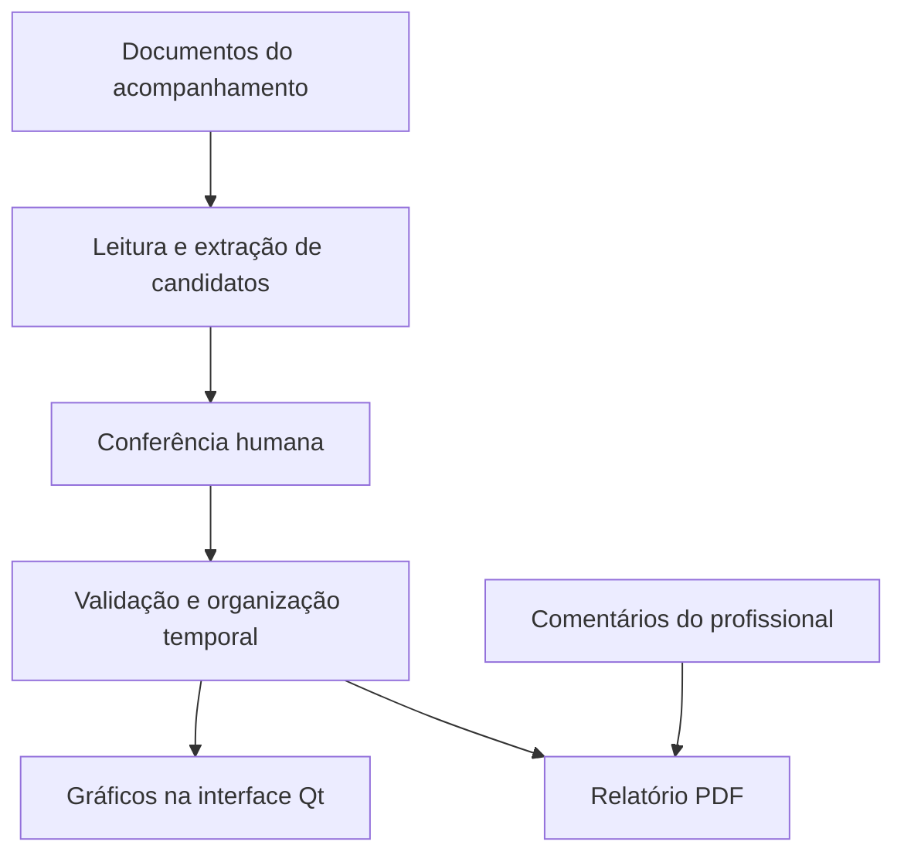
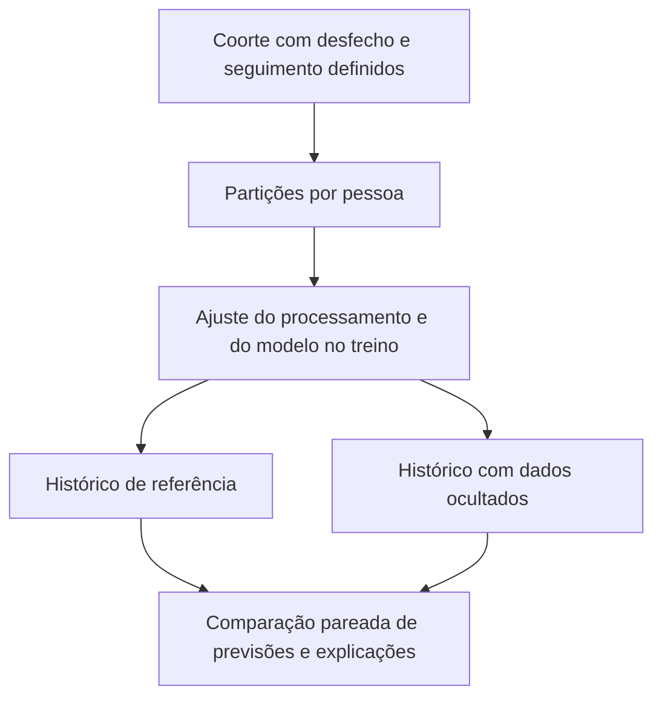

# Falciforme Explicável

### IA Explicável no acompanhamento longitudinal da doença falciforme

**Falciforme Explicável** é um projeto de pesquisa em Computação que reúne um protótipo desktop e uma investigação sobre explicações de modelos preditivos com dados laboratoriais incompletos.

O aplicativo organiza exames de diferentes momentos, permite conferir as informações extraídas e apresenta a evolução dos resultados em gráficos e relatórios. A pesquisa investiga como a falta de valores ou de coletas inteiras altera a previsão de um modelo e os fatores destacados por SHAP e LIME.

**Estágio atual:** a interface nativa em Python e Qt permite importar documentos, revisar dados, comparar coletas e exportar um PDF. O processamento básico roda no próprio computador, sem Streamlit, servidor web ou navegador. A janela ainda não integra um modelo de risco treinado nem produz probabilidades de crises.

## O problema

Exames de uma mesma pessoa podem estar distribuídos em documentos com formatos, unidades e datas diferentes. Antes de interpretar sua evolução, é necessário identificar a coleta, conferir os valores e reconhecer o que está ausente.

Esse problema também afeta a investigação de modelos preditivos. A falta de uma coleta pode impedir o cálculo de uma tendência e modificar tanto a previsão quanto sua explicação. Uma previsão semelhante não implica que os fatores destacados permaneçam semelhantes.

O projeto trata essas questões em duas frentes: organização documental revisável e avaliação computacional de previsões e explicações diante de dados incompletos.

## Objetivo e contribuição para a Computação

Desenvolver um protótipo local para organizar dados longitudinais e investigar a sensibilidade de modelos e métodos de explicação à ausência de informações.

A contribuição proposta é um protocolo reproduzível que compare históricos de referência com versões em que valores ou coletas foram ocultados de forma controlada. A análise registra separadamente a mudança na previsão, a estabilidade das explicações e o custo computacional.

A pergunta central é:

**Quando faltam valores ou coletas no histórico, quanto mudam a previsão e os fatores apontados por SHAP e LIME?**

Os objetivos específicos são:

- Extrair candidatos a resultados mantendo sua origem documental.
- Permitir revisão humana de valores, unidades e datas antes da análise.
- Representar coletas ao longo do tempo e preservar lacunas.
- Comparar modelos de referência com atributos pontuais e longitudinais.
- Avaliar explicações considerando a mudança da previsão e a variabilidade do próprio explicador.
- Investigar a compreensão das saídas por profissionais em casos simulados.

## Público e escopo

O público de referência é o médico, responsável por conferir os registros e interpretar o contexto clínico.

O protótipo mantém o escopo configurado em **CID D57.0**, com adequação ao caso confirmada pelo profissional. O código fixo delimita o projeto e não identifica automaticamente uma crise atual. O subtipo é informado pelo médico; o sistema não o deduz do hemograma.

Os exemplos distribuídos com o projeto são fictícios. A comparação laboratorial é descritiva e não classifica automaticamente uma variação numérica como melhora ou piora clínica.

## Fluxo da interface desktop

A janela organiza o atendimento em cinco etapas:

| Área | Finalidade |
| --- | --- |
| Paciente | Identificação opcional, idade, peso, altura e subtipo informado |
| Importar documentos | Seleção de arquivos e leitura assistida, com OCR local quando necessário |
| Conferir resultados | Revisão de valores, unidades, datas e origem das informações |
| Evolução | Comparação das coletas conferidas e visualização por parâmetro |
| Relatório | Comentários do profissional e exportação de PDF com identificação opcional |

A comparação exige ao menos duas coletas distintas. Alterar uma célula após a análise invalida o resultado anterior e desabilita a exportação até uma nova conferência.

A demonstração permite explorar o fluxo com dados fictícios. O leitor trabalha com um conjunto delimitado de parâmetros laboratoriais; a importação não equivale ao reconhecimento de qualquer exame ou formato de laudo.

## Arquitetura

O projeto utiliza uma **arquitetura desktop modular em camadas**, executada localmente:

- **Entrada documental:** leitura dos arquivos, OCR opcional e extração de candidatos rastreáveis.
- **Domínio analítico:** validação de datas e unidades, organização das coletas e comparação dos resultados.
- **Apresentação:** interface Qt, conferência humana, gráficos e exportação de PDF.
- **Pesquisa:** construção de atributos, treinamento experimental e métodos de explicação separados da interface.

A leitura documental ocorre em uma tarefa em segundo plano para manter a janela disponível durante o processamento. Os dados da sessão ficam em memória; o usuário escolhe onde salvar o relatório.

O **XH-KaaS** é uma referência conceitual para separar extração, apresentação e avaliação das explicações. O projeto não implementa integralmente essa arquitetura nem oferece atualmente uma API de explicabilidade.

## IA Explicável e desenho experimental

Os módulos de pesquisa incluem investigação de regressão logística, árvore de decisão e Random Forest. A comparação considera atributos clínicos, medidas pontuais e informações calculadas a partir de várias coletas. Esses módulos não disponibilizam automaticamente um modelo para a janela médica.

**T0** representa o instante de avaliação. Apenas dados disponíveis até esse momento podem compor a entrada. O desfecho candidato é uma nova crise vaso-oclusiva com atendimento em até 30 dias após T0, condicionado à disponibilidade de uma coorte com registros e seguimento adequados.

Ausência de registro não equivale a ausência confirmada de crise. A definição do desfecho e os critérios de acompanhamento precisam ser fixados antes do treinamento.

A análise principal mantém o modelo congelado e compara cada caso com sua versão modificada. As máscaras propostas abrangem valores isolados, grupos de parâmetros e coletas inteiras, em níveis de 0%, 10%, 20% e 40%, conforme a viabilidade.

O pré-processamento deve ser ajustado no treino. As avaliações de uma mesma pessoa permanecem na mesma partição, evitando compartilhar pacientes entre treino e teste.

### Métodos de explicação

- **SHAP:** atribui contribuições às variáveis em relação a uma referência.
- **LIME:** ajusta uma aproximação simples do comportamento do modelo na vizinhança de um caso.

As explicações devem usar a mesma saída e atributos alinhados. Repetições com entradas idênticas ajudam a distinguir a variabilidade interna do explicador do efeito da ausência de dados.

Explicar uma previsão não demonstra causalidade nem comprova que o modelo esteja correto.

### Avaliação planejada

| Dimensão | Medidas consideradas |
| --- | --- |
| Extração documental | Concordância de valor, unidade e data com uma transcrição revisada |
| Previsão | AUROC, average precision, sensibilidade, especificidade e F1 |
| Probabilidades | Brier e curva de calibração |
| Estabilidade das explicações | Sobreposição dos atributos mais relevantes, concordância de rankings e mudança da previsão |
| Fidelidade local | Erro da aproximação em perturbações reservadas, com definição compatível com o método |
| Custo computacional | Tempo de inferência e de explicação na mesma máquina |

Uma grande mudança na explicação precisa ser interpretada junto da mudança na previsão. Estabilidade, isoladamente, não comprova qualidade.

## O que já está disponível e o que falta

| Situação | Componentes |
| --- | --- |
| Implementado no desktop | Identificação do atendimento, importação assistida, conferência, comparação de coletas, gráficos e PDF |
| Implementado no núcleo de pesquisa | Rotinas experimentais de treinamento, inferência e explicações, separadas da janela |
| Ainda sem integração completa na janela | Cadastro detalhado de crises, referências editáveis e operações de pesquisa |
| Planejado para avaliação | Experimentos de ocultação de dados, generalização, calibração e utilidade das explicações com profissionais |

A existência de testes de software e rotinas experimentais não representa validação clínica. Ainda não há resultados que demonstrem eficácia no atendimento, superioridade de um explicador ou capacidade validada de prever crises.

## Tecnologias

| Tecnologia | Papel |
| --- | --- |
| Python | Processamento, validação e integração dos módulos |
| Qt e PySide6 | Interface desktop nativa |
| pandas | Organização e transformação dos dados tabulares |
| pypdf | Leitura de PDFs com texto extraível |
| pypdfium2, Pillow e Tesseract | Preparação de imagens e OCR local |
| Matplotlib | Gráficos incorporados à janela e usados nos relatórios |
| ReportLab | Geração do PDF |
| scikit-learn, SHAP e LIME | Investigação de modelos e explicações |
| PyInstaller | Empacotamento da distribuição desktop |

A versão desktop substitui a interface Streamlit e os gráficos Plotly. O núcleo de leitura, validação e comparação é reaproveitado na arquitetura atual.

## Perguntas em aberto e próximos passos

Além da pergunta computacional, o projeto investiga qual utilidade a explicação pode ter para o profissional. Ela ajuda a reconhecer lacunas, questionar uma previsão ou perceber uma saída pouco confiável? Pode também aumentar a confiança em uma previsão incorreta?

O peso da saída do sistema na decisão médica ainda não foi estabelecido. Uma avaliação proposta compara casos simulados apresentados com previsão e com previsão acompanhada de explicação, observando compreensão e reconhecimento de limitações.

As próximas etapas são:

1. Avaliar a extração em laudos variados, comparando-a com uma referência conferida.
2. Verificar a disponibilidade de uma base longitudinal e definir desfecho, horizonte e seguimento.
3. Executar comparações de modelos e experimentos pareados com dados ausentes.
4. Integrar os recursos de acompanhamento que ainda faltam na janela desktop.
5. Avaliar compreensão e utilidade com profissionais em casos simulados.
6. Validar a distribuição e o fluxo de uso em Windows e Linux.

## Privacidade e responsabilidade

O fluxo básico processa documentos localmente, sem envio a APIs externas. A janela não exige login nem mantém um banco de pacientes. A identificação é usada na sessão e pode ser incluída no PDF por escolha do usuário.

Arquivos originais e relatórios exportados permanecem no computador. O OCR pode criar arquivos temporários locais, removidos ao concluir a leitura. Limpar a sessão não apaga os documentos de origem, os PDFs salvos ou possíveis vestígios no sistema operacional.

Nos experimentos, os participantes devem receber identificadores pseudônimos. O nome não compõe os atributos numéricos de pesquisa.

O protótipo não realiza diagnóstico nem prescreve. A aplicação de suas saídas em decisões clínicas depende de avaliação específica, além dos testes de funcionamento do software.

## Fundamentação

| Referência | Papel no projeto |
| --- | --- |
| [Montenegro e Lino (2024) — XH-KaaS](https://doi.org/10.5753/sbsi_estendido.2024.238984) | Organização conceitual dos componentes de explicabilidade |
| [Lundberg et al. (2020) — Explicações locais e compreensão global de modelos de árvores](https://doi.org/10.1038/s42256-019-0138-9) | Fundamentação das atribuições SHAP em árvores |
| [Garreau e von Luxburg (2020) — Primeira análise teórica do LIME](https://proceedings.mlr.press/v108/garreau20a.html) | Propriedades e limites das aproximações locais |
| [Hu et al. (2022) — Predição precoce do prognóstico na lesão renal aguda](https://doi.org/10.1016/j.csbj.2022.06.003) | Referência aplicada de prognóstico com SHAP e LIME |
| [Piel et al. (2023) — Estratégias globais para melhorar os desfechos na doença falciforme](https://doi.org/10.1016/S2352-3026(23)00096-0) | Contexto do domínio de aplicação |
| [Lopes et al. (2021) — Predição da gravidade da hemofilia A com poucas entradas](https://doi.org/10.1038/s41540-021-00183-9) | Referência de modelagem em hematologia, em coautoria com Tatiane Nogueira Rios |
| [Collins et al. (2024) — TRIPOD+AI](https://doi.org/10.1136/bmj-2023-078378) | Relato do desenvolvimento e da avaliação de modelos preditivos |

As referências fundamentam decisões de arquitetura e método. Resultados obtidos em outras doenças não validam previsões de crises na doença falciforme.