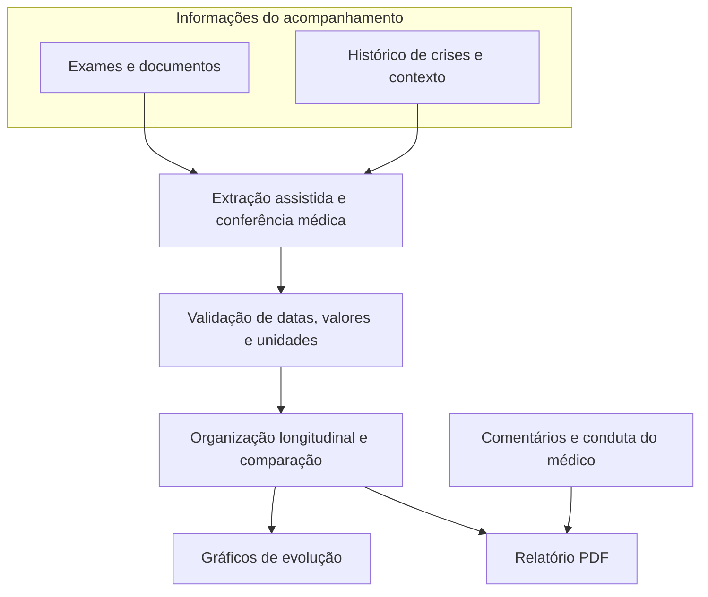
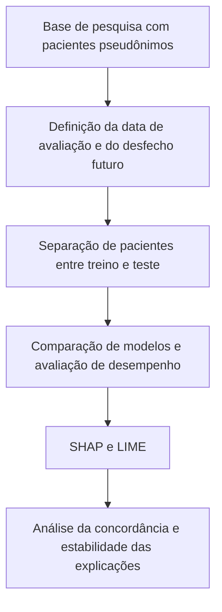

# Falciforme Explicável

### IA Explicável para o acompanhamento de crises na doença falciforme

**Falciforme Explicável** é um projeto de pesquisa em Computação voltado ao desenvolvimento de um sistema de apoio à avaliação médica. A proposta reúne exames, documentos e histórico de crises para apresentar a evolução do paciente de forma organizada, visual e compreensível.

O projeto combina processamento de dados longitudinais, aprendizado de máquina e métodos de explicabilidade. Seu desenvolvimento parte de uma pergunta: **como transformar informações de diferentes momentos do acompanhamento em evidências que o médico consiga analisar e, futuramente, em estimativas de risco que também possam ser explicadas?**

> **Estágio atual:** o protótipo permite conferir dados, comparar exames e gerar gráficos e relatórios. A interface médica ainda não possui um modelo de risco treinado integrado. As previsões explicáveis fazem parte da linha de pesquisa em desenvolvimento.

## O problema

Exames e relatos de crises representam momentos diferentes da trajetória do paciente. Quando essas informações permanecem distribuídas em documentos isolados, sua comparação exige organizar datas, conferir unidades e reconstruir o histórico disponível.

O Falciforme Explicável propõe reunir esses registros em uma visão longitudinal, preservando a origem dos dados e a participação do médico na conferência e interpretação dos resultados.

## Objetivo do projeto

Desenvolver e avaliar um sistema computacional que organize a evolução laboratorial e o histórico de crises, apoiando a análise médica e investigando o uso de IA Explicável para estimativas futuras de ocorrência de crises.

Os objetivos específicos são:

- Estruturar informações de exames e documentos de diferentes períodos.
- Representar a evolução dos parâmetros laboratoriais ao longo do tempo.
- Relacionar o histórico de crises aos dados disponíveis em cada avaliação.
- Investigar modelos com dados pontuais e longitudinais.
- Analisar as explicações produzidas por SHAP e LIME.
- Apresentar os resultados de maneira compreensível e revisável pelo médico.
- Priorizar processamento local e identificação temporária do paciente.

## Público e escopo

O sistema é destinado ao **médico**, responsável por conferir os registros, interpretar os resultados e definir a conduta.

O escopo configurado é **CID D57.0 — Anemia falciforme com crise**, cuja adequação ao caso deve ser confirmada pelo profissional. O código fixo delimita o projeto; não comprova a existência de uma crise atual.

O subtipo informado pelo médico é registrado como contexto. O sistema não tenta identificá-lo a partir do hemograma.

## Como funciona

O atendimento é organizado em cinco áreas:

| Área | Finalidade |
| --- | --- |
| **Paciente** | Identificação temporária e informações como idade, peso, altura e subtipo informado |
| **CID e contexto clínico** | Conferência do escopo, tratamento e intercorrências relevantes |
| **Histórico de crises** | Registro do período, tipo de evento, atendimento, fonte e confirmação médica |
| **Exames e documentos** | Entrada de dados e revisão das informações extraídas |
| **Análise e relatório** | Comparação dos exames, gráficos, comentários do médico e exportação PDF |

As entradas podem ser digitadas, importadas por CSV ou extraídas de documentos PDF com texto, DOCX e TXT. Antes da análise, o médico revisa datas, unidades e valores. Os gráficos mostram o histórico disponível e a comparação tabular apresenta até as três últimas coletas.

No histórico de crises, datas incompletas permanecem com a precisão conhecida. Um registro sem dia exato não recebe uma data inventada, e ausência de registro não é interpretada automaticamente como ausência de crise.

## Arquitetura

O fluxo atual separa a entrada de informações, a conferência médica, o processamento longitudinal e a apresentação dos resultados.

A investigação de modelos ocorre em um ambiente de pesquisa separado. A conexão desses modelos com a interface médica ainda precisa ser implementada e avaliada.

## IA Explicável na proposta

A pesquisa considera **regressão logística, árvore de decisão e Random Forest**. A comparação envolve informações clínicas, resultados de uma coleta e atributos calculados a partir da evolução de várias coletas.

Além do desempenho preditivo, o projeto busca examinar como o modelo utiliza essas informações:

- **SHAP:** estima a contribuição das variáveis para uma previsão em relação a uma referência.
- **LIME:** constrói uma aproximação simples do comportamento do modelo nas proximidades de uma observação.

A comparação das explicações procura identificar concordâncias, diferenças e sensibilidade à repetição dos procedimentos. Explicar uma previsão não demonstra que uma variável cause o evento, nem garante que o modelo esteja correto.

A avaliação experimental inclui sensibilidade, especificidade, F1, ROC-AUC, average precision, Brier e curva de calibração. Os dados usados na previsão devem estar disponíveis até a data de avaliação; informações posteriores pertencem ao desfecho e não podem entrar como atributos de entrada.

## O que já está disponível

- Interface médica com cinco áreas de acompanhamento.
- Identificação temporária, contexto e histórico de crises.
- Entrada e leitura assistida de exames e relatórios.
- Comparação de resultados laboratoriais e gráficos longitudinais.
- Referências do laudo e valores basais opcionais, revisados pelo médico.
- PDF com gráficos, comentários e conduta registrada pelo profissional.
- Ferramenta separada para treinamento e comparação experimental de modelos.
- Módulos de pesquisa para SHAP, LIME e comparação de explicações.

**Ainda em desenvolvimento:** integração de um modelo revisado à interface médica, avaliação com dados adequados ao objetivo de previsão e validação do desempenho e da utilidade das explicações. Treinar na ferramenta de pesquisa não disponibiliza automaticamente um modelo para o atendimento.

## Tecnologias e organização

O projeto utiliza **Python** para processamento e validação, **Streamlit** para a interface, **pandas** para dados tabulares, **Plotly** para gráficos interativos e **Matplotlib e ReportLab** para o relatório PDF. A investigação de modelos utiliza **scikit-learn, SHAP e LIME**.

A organização separa a interface médica, as regras de análise, o histórico temporal, a leitura de documentos, a geração de relatórios e os módulos de pesquisa. Essa divisão permite evoluir o trabalho experimental sem expor operações de treinamento no atendimento.

## Privacidade e responsabilidade

O processamento é local, sem envio a APIs externas. Não há login nem banco de pacientes; a identificação é utilizada na sessão e, opcionalmente, no PDF. O nome não integra os atributos numéricos de pesquisa.

Os relatórios exportados permanecem no computador e precisam ser protegidos. Limpar a sessão não apaga downloads nem garante remoção de vestígios no navegador ou no sistema operacional.

O protótipo não realiza diagnóstico, não prescreve e não classifica automaticamente uma variação numérica como melhora ou piora clínica. As referências e os valores basais exigem revisão profissional. **Testes de software e métricas experimentais não substituem validação clínica.**

## Fundamentação

| Referência | Papel no projeto |
| --- | --- |
| [XH-KaaS](https://doi.org/10.5753/sbsi_estendido.2024.238984) | Referência conceitual para organização de conhecimento e explicabilidade |
| [A Unified Approach to Interpreting Model Predictions](https://arxiv.org/abs/1705.07874) | Fundamentação do SHAP |
| [“Why Should I Trust You?”: Explaining the Predictions of Any Classifier](https://doi.org/10.1145/2939672.2939778) | Fundamentação do LIME |
| [Application of interpretable machine learning for early prediction of prognosis in acute kidney injury](https://doi.org/10.1016/j.csbj.2022.06.003) | Apoio metodológico para investigação de modelos interpretáveis |
| [eXplainable Ensemble Strategy using distinct and restrict learning biases: A case study on the Brazilian Forest](https://doi.org/10.1016/j.asoc.2022.109976) | Referência complementar sobre ensembles e explicabilidade |

O projeto não implementa integralmente o XH-KaaS. Estudos de outros domínios oferecem apoio computacional e metodológico; seus resultados não validam previsões de crises na doença falciforme.
